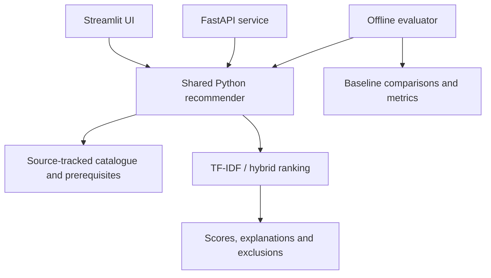

# CoursePilot

Explainable elective recommendations using TF-IDF, weighted interests and prerequisite rules.

**Developer:** Sobaan Nayyar · Individual implementation for the FAST-NUCES Recommender System course. [AI assistance disclosure](docs/AI_ASSISTANCE.md).

[](https://github.com/sobaannr/CoursePilot/actions/workflows/test.yml)

**Working implementation:** Streamlit app, reusable Python ranker, FastAPI service, 74-row source-tracked catalogue, baseline comparisons, tests, human-study collection/import tools, and a three-page report.

**Submission status:** software and authored-scenario experiments are complete. Actual student feedback has **not** been collected. The 2026 national catalogue is not a verified Karachi 2023-batch elective list. Credits not stated in the source are null. Do not present the included demo metrics as human-study results or the candidate pool as confirmed semester offerings.

## Run locally

Python 3.12 is recommended. From the project directory:

```powershell
python -m venv .venv
.venv\Scripts\python.exe -m pip install -r requirements-dev.txt
.venv\Scripts\python.exe -m streamlit run app.py --server.address 127.0.0.1 --server.port 8517
```

After installing dependencies, double-click `Start CoursePilot.cmd`, or run the last command above. Open http://127.0.0.1:8517. Stop the process with Ctrl+C. If the port is occupied, use another port. No API key or remote model is required.

On macOS/Linux, replace `.venv\Scripts\python.exe` with `.venv/bin/python`.

`requirements-lock.txt` records the installed environment. Use it for exact version replay on Python 3.12; the smaller requirements files describe direct dependencies. Package installation needs internet; application inference does not.

## First demo (two minutes)

1. Select **AI engineer** or **My own profile**. Enter any field in **Your field or career goal**, choose your actual completed courses, and click **Find my courses**. Presets only fill suggested goals and interests.
2. Expand a course's explanation. Term contributions reconstruct the cosine score.
3. Switch to **TF-IDF + topics** and submit. Inspect the two additive score components.
4. With `CS2001` selected but `CL2001` absent, search for deep learning. `CS4045` is excluded because its lab prerequisite is not satisfied. Add the lab in a test profile to compare eligibility.
5. Open **Experiments** to compare methods. The visible results are explicitly authored scenarios.

For your own profile, select **My own profile** and enter only courses actually completed. Theory and lab codes are separate. Empty/unknown inputs return no evidence rather than a misleading personalized shortlist.

## Reproduce checks and experiments

```powershell
.venv\Scripts\python.exe -m pytest -q
.venv\Scripts\python.exe -m coursepilot.evaluate
.venv\Scripts\python.exe scripts\build_report.py
```

Results: `output/evaluation/metrics.json`, `per_profile.csv`, `RESULTS.md`. The report generator uses these actual results. It never fabricates human metrics.

## Local API

```powershell
.venv\Scripts\python.exe -m uvicorn coursepilot.api:app --host 127.0.0.1 --port 8017
```

Interactive schema: http://127.0.0.1:8017/docs. Routes: `GET /health`, `GET /courses`, `POST /recommend`.

Example JSON body:

```json
{"query":"build personalized recommendations","interests":{"recommender systems":5,"machine learning":2},"completed":["CS1002","CL1002","CS1004","CL1004","CS2001","CL2001"],"k":5,"method":"hybrid","alpha":0.75}
```

The response includes excluded courses/reasons, exact term and component contributions, dataset/model versions and in-process latency. Invalid codes/weights fail with 422. The API is stateless and intended for local/course demos; public hosting would require operational review and appropriate request limits.

## Docker

```sh
docker build -t coursepilot .
docker run --rm -p 127.0.0.1:8517:8501 coursepilot
```

For the API, override the image command with `uvicorn coursepilot.api:app --host 0.0.0.0 --port 8017` and publish that port to localhost. Docker configuration is supplied; see `docs/VERIFICATION.md` for what was actually exercised.

## What is included

| Path | Purpose |
|---|---|
| `app.py` | Recommendation, catalogue, experiments and study UI |
| `coursepilot/` | Ranking, validation, metrics, study imports and API |
| `data/courses.json`, `.csv` | 74 source-tracked entries; 54 candidate electives |
| `data/curation.tsv` | Editable descriptions, topic tags and project roles |
| `data/evaluation/benchmark_demo.json` | 18 explicitly fictional labelled profiles |
| `scripts/build_report.py` | Generate a three-page report locally from evaluation results |
| `docs/METHODOLOGY.md` | Equations, baselines, edge cases and design decisions |
| `docs/DATA_CARD.md` | Provenance, schema and curriculum limitations |
| `docs/HUMAN_STUDY.md` | Consent, sampling, rating and analysis protocol |
| `docs/DEMO_AND_VIVA.md` | Demonstration script and explanations to prepare |
| `docs/AI_ASSISTANCE.md` | Honest assistance disclosure and attribution guidance |
| `tests/` | Functional, API, data, metric, UI and study checks |

## Real student evaluation

Follow `docs/HUMAN_STUDY.md`. The interface can prepare an unranked judgment packet before recommendations are shown. No response is sent anywhere automatically.

```powershell
.venv\Scripts\python.exe scripts\import_human_study.py --profiles data/human/private/profiles.json --ratings data/human/private/ratings.csv
.venv\Scripts\python.exe -m coursepilot.evaluate --benchmark data/human/private/benchmark.json --output output/human_evaluation
.venv\Scripts\python.exe scripts\summarize_feedback.py --input data/human/private/shortlist_feedback.csv --output output/human_evaluation/feedback_summary.json
.venv\Scripts\python.exe scripts\build_report.py --human-metrics output/human_evaluation/metrics.json --feedback-summary output/human_evaluation/feedback_summary.json
```

Independent catalogue judgments and post-ranking feedback are different studies. Do not mix the files or use partial shortlist feedback to claim Recall@K.

## Data provenance and appropriate claims

The official [FAST programme page](https://nu.edu.pk/Admissions/ProgramOffered) links to the [2026 computing catalogue](https://drive.google.com/file/d/1lEyDHS2W41ixoCpD0wQdmYW7yaZeCAy9/view). Source page numbers and a source checksum are preserved. No source claims semester availability. We deliberately preserve the discrepancy between the source's core/elective labels and the project candidate roles.

Download the source PDF to `data/sources/fast_computing_catalogue_2026.pdf` and run `python scripts/build_catalogue.py` to rebuild. Downloaded source PDFs are excluded from this public repository. Curated summaries and tags are inspectable. Catalogue changes invalidate the evaluation fingerprint until judgments are revalidated.

The original proposal's possible embedding extension is optional and not implemented: the delivered core is inherently explainable and requires no neural model. Limited, explicit domain lemmatization is used rather than a full morphological language model.

This repository publishes the source code and authored diagnostic results. No public application deployment, student recruitment or course submission is claimed.

## Architecture



Streamlit calls the engine directly; FastAPI is a separate interface. Both cache their own engine instance. There is no persistent student-account database or external model dependency.

## Public repository scope

Includes runnable source, tests, dependency specifications, CI/Docker configuration, curated catalogue data, fictional benchmarks and reproducible evaluation outputs. Original assignment documents, downloaded source PDFs, CVs, interview notes, private study responses, logs, virtual environments and submission archives are excluded.

