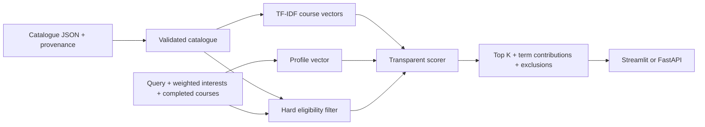

# Methodology and architecture

## Data flow

The catalogue contains core/support entries needed to interpret completed courses and prerequisite references, plus the project candidate pool. Only candidate electives can be returned. Catalogue inclusion does not mean a course is offered this semester.

## Preprocessing and TF-IDF

Text is lowercased and tokenized with an explicit regex. English stop words are removed. A conservative domain lemma dictionary maps forms such as `algorithms -> algorithm` and `matrices -> matrix`; unmatched words are preserved. Common aliases (`AI`, `ML`, `NLP`, `cybersecurity`) are expanded. This is limited lexicon-based lemmatization, not a full linguistic analyzer. No hidden network downloads occur.

Each document is its title plus a short curated description. All 74 catalogue entries participate in IDF; only 54 are candidates. Tags are not added to document text, keeping the explicit topic term interpretable.

For term t in course d, sklearn uses sublinear TF (1 + log(count)), smoothed IDF `log((1 + N)/(1 + df(t))) + 1`, then L2 normalization. The course vector is x_d. The free-text query vector is q. Each selected interest is vectorized; their weighted average is normalized into i. If both are nonzero, `p = normalize(q + i)`; if only one is nonzero it is used alone. Thus the query and the combined interest channel receive equal weight before final normalization. Positive interest weights range from 1 to 5 in the UI (API accepts values in (0,5]).

The baseline score is `s_text(d) = x_d dot p`. Since TF-IDF is nonnegative and vectors are normalized, this lies in [0,1]. The contribution of term t is exactly `x_d[t] * p[t]`. The full displayed term table reconstructs the score; a top-term summary is only a summary, not the whole sum.

## Transparent extension

`s_topic(d) = sum(weight[t] for selected tags also assigned to d) / sum(selected weights)`.

`s_hybrid(d) = 0.75 * s_text(d) + 0.25 * s_topic(d)` by default. If there are no selected interests, use text alone. Alpha can be supplied via the API. Weights are fixed design choices, not learned or tuned on the test fixtures. Each component is exposed. A match score is not a probability of enjoyment, completion or academic success.

## Hard constraints

Before ranking, reject completed courses, non-elective project roles and unknown prerequisite status. `prerequisite_groups` is an AND of OR groups: `[[A,B],[C]]` means `(A OR B) AND C`. Source comma-separated codes are modeled as individual required groups. Lab prerequisites remain independent; completing CS2005 alone never implies CL2005. Listed `N/A` means no prerequisite stated in the source, and the UI warns about its limited authority. The engine trusts the student's supplied completion list and does not infer their earlier transcript or recursively waive prerequisites.

All rankers use the same filtered pool. Zero-evidence deterministic results are omitted rather than padded; empty profiles and out-of-vocabulary queries can abstain. Ties use course code. An unknown completed code is an error, not silently ignored.

## Baselines and ablations

- `tfidf`: proposed weighted-profile cosine ranking.
- `hybrid`: transparent combination described above.
- `keyword`: fraction of unique query/interest tokens appearing in course text; uses the same preprocessing.
- `random`: pseudorandom scores on eligible candidates; averaged across seeds 0..19.
- `text_only`: TF-IDF with interests removed.
- `topics_only`: explicit topic score with free text removed (alpha zero).

Random is not displayed as a personalized option in the main UI. Its explanations in API output are labelled baseline components; only TF-IDF/hybrid term contributions claim to explain their score.

## Evaluation

Grades 0..3 describe irrelevant through highly relevant. Grades >=2 count as binary relevance. Precision@K divides relevant returned items by requested K (abstention loses slots). Recall@K divides by all relevant eligible items. NDCG uses `(2^grade - 1)/log2(rank+1)` and the ideal eligible ordering. Recall/NDCG are undefined when their denominator is zero; those cases are omitted with the per-metric N reported. Precision remains defined.

Every eligible course must have an explicit grade. Missing judgments, duplicate profiles, unknown IDs, participant overlap between development/test, and mismatched catalogue fingerprints are rejected. For repeated profiles, average within participant before reporting means. Random seeds are averaged within profile. Percentile intervals use 2,000 participant-level bootstrap replicates with seed 42; intervals on authored demo cases are descriptive only.

The included 18 fictional profiles have manually assigned positive grades and explicit zeros elsewhere. Six are designated development and twelve test, solely to exercise the workflow. They are not independent user data; authors know the descriptions and tags. High scores are expected to be optimistic. No hyperparameter search is conducted. Fit IDF on the fixed available catalogue, which is item content, never relevance labels.

## Runtime and scope

Exact scoring is appropriate for this small catalogue. Inference needs no LLM, vector database or remote API. An in-memory model is cached; requests do not mutate the catalogue. Latency measures full in-process scoring/explanation generation, not concurrent network throughput. Student information is held in the Streamlit session and exported only on request. The local API has no authentication layer and is not advertised as hardened public infrastructure.

Future work: verify batch-specific roles/credits, collect blinded student labels, inspect error groups, then consider diversity reranking or a separately approved embedding comparison. These are not claimed as implemented.
